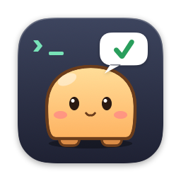

<p align="center">
  
</p>

<h1 align="center">텀펫</h1>

<p align="center">Claude Code와 터미널 작업이 끝나면 알려주는 macOS 데스크톱 펫</p>

## 기능

- Claude Code 응답 완료·권한 요청 알림
- 30초 이상 걸린 터미널 명령 완료 알림
- 말풍선 클릭 시 해당 Cursor / VSCode 프로젝트 창으로 이동
- 기본 캐릭터 4종, 이미지로 내 캐릭터 만들기

## 설치

```bash
brew install --cask anjinhyeong/tap/termpet
```

macOS 14 이상

## 설정

**Claude Code** — `~/.claude/settings.json`

```json
{
  "hooks": {
    "Stop": [{ "hooks": [{ "type": "command", "command": "$HOME/.termpet/bin/termpet-hook claude", "timeout": 5 }] }],
    "Notification": [{ "hooks": [{ "type": "command", "command": "$HOME/.termpet/bin/termpet-hook claude", "timeout": 5 }] }]
  }
}
```

**zsh** — `~/.zshrc`

```zsh
[[ -f ~/.termpet/zsh-integration.zsh ]] && source ~/.termpet/zsh-integration.zsh
```

자세한 내용은 [docs/SETUP.md](docs/SETUP.md)

## 지원 터미널

| 앱 | 말풍선 클릭 시 |
|---|---|
| Cursor, VSCode, Windsurf, Zed | 프로젝트 창으로 이동 |
| Terminal, iTerm2, Warp, Ghostty, WezTerm, kitty | 앱 활성화 |

## 개발

```bash
Scripts/run.sh          # 빌드 + 실행
Scripts/install.sh      # /Applications 에 설치
Scripts/release.sh <버전>   # GitHub Release + Homebrew 갱신
```

## 라이선스

MIT
